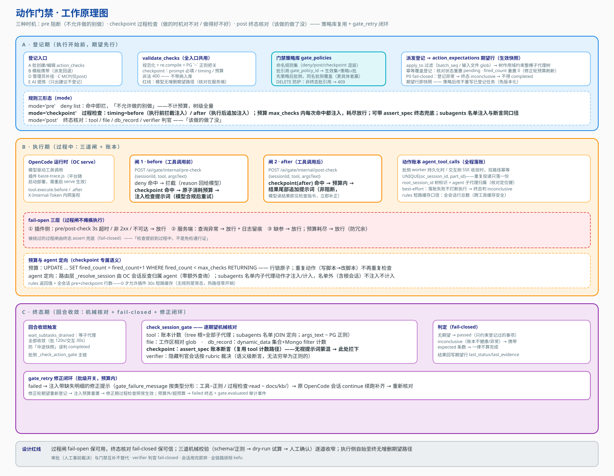

# 13 · 动作门禁原理与数据库设计

> 定位：门禁功能的**原理总览 + 原理图 + 数据库设计**一册通。机制细节（函数级行号、引擎挂点、HTTP 契约）以 [05-动作门禁与审批](./05-动作门禁与审批.md) 为正本；过程检查（checkpoint）与门禁策略库以 [2026-10-11 设计 spec](../superpowers/specs/2026-10-11-gate-checkpoint-policy-design.md) 为准，本册把两者合到同一张图、同一套数据模型里讲。
> 上游：[00-总览与功能清单](./00-总览与功能清单.md) · [03-批任务与执行引擎](./03-批任务与执行引擎.md) · [01-总体架构与运行时](./01-总体架构与运行时.md)

## 1. 功能定位：四个问题

动作门禁回答四个问题，分别对应四种机制：

| 问题 | 机制 | 时机 |
| --- | --- | --- |
| 不允许做的别做 | **pre 阻断**（deny list） | 工具调用前，命中即拦 |
| 做的时机对不对 / 做得好不好 | **checkpoint 过程检查**（执行前/后注入检查提示词） | 动作前后，过程中纠偏 |
| 该做的做了没 | **post 终态核对**（账本/效果断言/verifier 判官） | 回合终态 |
| 高危动作先问人 | **审批**（人工事前裁决） | 执行前挂起 |

四种机制共用同一套登记入口、同一张期望表、同一个账本；审批与门禁互补、不互相替代。

## 2. 工作原理

### 2.1 原理图



### 2.2 登记期：期望先行，策略复用

**登记先于派发**——期望在执行开始前登记，不存在"执行中才登记、错过早期动作"的漏登窗口。五个入口：

- **A 批创建/编辑**（`action_checks` 参数）与 **B 模板携带**：确定性登记，人工确认 + 服务端校验，非法 400 不带病入库；
- **C MCP `register_action_check`**：模型自主登记（仅 tool 型 post 期望，无删除路径——"模型不能增删已登记期望"红线）；
- **D 管理员补挂**：运行中/排队中子会话逐会话挂，仅 admin；
- **E AI 提炼**：只产出建议预填表单，登记仍走人工确认。

全入口共用 `validate_checks` 规范器：name 唯一 ≤100 字、`args_pattern` 先过 Python `re.compile` 再按 **PG `~` 口径**校验（登记/dry-run/核对三处同口径）、checkpoint 规则的 prompt/timing/预算/断言逐项把关。

**门禁策略库**解决"每建一个任务重配一套门禁"的复用问题：命名的规则集（deny/post/checkpoint 三种 mode 混装）存 `gate_policies`，批任务经 `gate_policy_id` 引用即生效。生效规则 = **策略 ∪ 批自身**（批缺省回退模板），合并由 `merged_action_checks` 单一函数产出（worker 派发、UI 编辑、OpenAPI 三个消费方同源）；登记顺序先策略后批侧——同名规则批侧覆盖策略侧（更具体者赢，去重发生在登记层的 name 幂等覆盖，不在合并层，以保住 `apply_to` 定向场景）。派发时按 `apply_to`（batch_seq / 输入文件 glob）过滤后落成 `action_expectations` 期望行——**期望行就是该任务生效规则的快照**，策略后改不重写已登记任务，因此策略不需要版本机制；策略 DELETE 只需防护非终态批引用（409）。

### 2.3 执行期：三道闸 + 账本

OC 插件 `baize-trace.js`（平台随启动部署进 OpenCode 全局插件目录，变更需重启 serve）注册 `tool.execute.before` / `tool.execute.after` 两个钩子，把每次工具调用送到平台内网端点校验：

- **闸 1 · before（`/ai/gate/internal/pre-check`）**：先判 deny（`mode='pre'` 命中即拦，理由回给模型，优先级最高）；再判 checkpoint-before——按登记序取第一条"匹配且预算可用"的行，**原子消耗注入预算**（`UPDATE … SET fired_count=fired_count+1 WHERE fired_count<max_checks RETURNING`，行锁保证并发安全）后拦截注入检查提示词，模型合规后重试；预算耗尽放行（重复动作——写脚本→改脚本——不再重复检查）。
- **闸 2 · after（`/ai/gate/internal/post-check`）**：checkpoint-after 命中且预算内时，把检查提示词**追加到工具结果尾部**（非阻断，探针实测：after 钩子抛错会把结果摧毁成 error，故取追加形态），模型读结果即见检查指令、立即补正。
- **账本**：批侧 worker 持久化时、交互侧 SSE 收敛时双路径落账 `agent_tool_calls`，幂等键 `(oc_session_id, part_id)`；`root_session_id` 树标识 + `agent` 子代理归属是核对与定向的定位键。落账 best-effort——失败不打断执行，终态判 inconclusive。

两道过程闸都是 **fail-open 三层**（插件 3s 超时/非 2xx 放行、服务端异常放行留痕、缺参放行）——拦截基础设施故障不得瘫痪全部工具调用；被绕过的过程闸由终态 assert 兜底。**agent 定向**：路由层由 OC 会话 id 反查归属子代理名（`_resolve_session`，复用既有映射查询零额外开销），`subagents` 名单内子代理的动作才注入/计入，名单外（含根会话自身）不注入不计入——注入与断言同一张名单说话。插件的 `rules=0` 短路缓存按**全会话规则总数**计（无规则是常态，热路径零开销；按工具计会让"先读后写"流把全会话误缓存成无规则）。

### 2.4 终态期：机械核对 + fail-closed + 修正闭环

回合收敛 → `wait_subtasks_drained`（等子代理全部收敛，防"中途快照"误判）→ `check_session_gate` 逐期望核对：tool 账本计数（树作用域 + subagents 定向 JOIN）、file 工作区 glob、db_record 集合计数、verifier 判官（隐藏 OpenCode 会话按 rubric 裁决语义级断言）、checkpoint 的 `assert_spec` 账本断言（复用 tool 计数路径——**模型无视过程提示词蒙混过关，在此拦下**）。判定 fail-closed：inconclusive（账本不健康/核对异常）携带 expected 条数、一律不算完成；failed → **gate_retry**（批级开关，预算内）注入带缺失明细的修正提示、原会话 continue 续跑补齐、重新核对——修正轮期望重新登记、注入预算重置，修正期过程检查照常生效。

## 3. 数据库设计

### 3.1 表关系总览

```
gate_policies（策略库）
    ▲ gate_policy_id 引用
ai_chat_batches ──action_checks/gate_retry（承载列）      ai_chat_prompt_templates.action_checks（模板承载）
    │ 派发：merged_action_checks = 策略 ∪ 批（apply_to 过滤）
    ▼
action_expectations（期望行 = 生效快照）═══ mode: pre / checkpoint / post
    ▲ scope_id = 平台会话 id                        subagents 名单 ──▶ ai_chat_subtasks.agent（子代理归属）
    │ 核对读                                        root_session_id 树 ──▶ scope 展开定位于执行账本
    ▼
agent_tool_calls（动作账本）──subtask_id FK──▶ ai_chat_subtasks
ai_execution_attempts ◀── gate.evaluated 审计事件        ai_skill_fit_results ◀── verifier verdict
ai_approval_requests（审批：结构节点/策略拦截创建）
```

### 3.2 `agent_tool_calls` —— 动作账本（迁移 `2026_09_20`）

| 列 | 类型 | 说明 |
| --- | --- | --- |
| `id` | BIGSERIAL PK | |
| `oc_session_id` | VARCHAR(100) NOT NULL | 动作所在 OC 会话 id（根/批子会话/子代理） |
| `root_session_id` | VARCHAR(100) | 树根平台会话 id——树作用域核对的定位键 |
| `subtask_id` | VARCHAR(100) FK→ai_chat_subtasks CASCADE | 子代理动作归属的子任务行 |
| `agent` | VARCHAR(100) | 子代理名（`subagents` 定向核对/注入的过滤键） |
| `message_id` / `part_id` | VARCHAR(100)（part_id NOT NULL） | 来源 part 定位；**UNIQUE(oc_session_id, part_id) 幂等键**——轮询/快照重复投递只落一份 |
| `tool` / `args_text` | VARCHAR(50) NOT NULL / TEXT | 工具名 + 入参压平文本（`k=value` 形状，截断 8192）——正则匹配对象 |
| `state` | VARCHAR(20) | pending/running/completed/error；核对默认只认 completed |
| `occurred_at` | TIMESTAMPTZ NOT NULL DEFAULT now() | 落账时刻（非真实执行时刻） |

索引：`idx_agent_tool_call_q(oc_session_id, tool, state)`（核对/时间线）、`idx_agent_tool_call_agent(agent)`（定向）。另有 `started_at`/`duration_ms` 两列（迁移 `2026_10_10`）属性能分析特性，门禁核对不消费。

### 3.3 `action_expectations` —— 期望表（核心，三次迁移叠加）

| 列 | 类型 | 来源 | 说明 |
| --- | --- | --- | --- |
| `id` | BIGSERIAL PK | 09_20 | |
| `scope_type` | VARCHAR(20) NOT NULL | 09_20 | `session`（只根会话）/ `tree`（根+全部子代理，默认） |
| `scope_id` | VARCHAR(100) NOT NULL | 09_20 | 平台会话 id（登记作用域；子代理经映射归入根） |
| `name` | VARCHAR(100) NOT NULL | 09_20 | 规则名；**UNIQUE(scope_type, scope_id, name)** 幂等覆盖键 |
| `tool` / `args_pattern` | VARCHAR(50) NOT NULL / TEXT NOT NULL | 09_20 | 匹配对象（tool 型）；PG `~` 口径 |
| `require_state` / `min_count` | VARCHAR(20) DEFAULT 'completed' / INT DEFAULT 1 | 09_20 | 核对门槛 |
| `source` | VARCHAR(30) DEFAULT 'batch' | 09_20 | batch / mcp |
| `check_type` | VARCHAR(20) NOT NULL DEFAULT 'tool' | 09_20 | tool / file / db_record / verifier |
| `effect_spec` | JSONB | 09_20 | file=工作区相对 glob；db_record=collection+Mongo filter；verifier=rubric（≤2000 字） |
| `subagents` | JSONB | 09_20 | 子代理名数组（≤10）——**注入与断言共用的 agent 定向名单** |
| `last_status` / `last_checked_at` / `last_evidence` | VARCHAR(20) / TIMESTAMPTZ / INT | 09_20 | 核对回写：pending → passed/failed（inconclusive 的 verifier 行重置 pending） |
| `mode` | VARCHAR(10) NOT NULL DEFAULT 'post' | 09_26 | **post / pre / checkpoint**（'checkpoint' 恰 10 字符）；`idx_action_expectation_mode(scope_id, mode)` 热路径窄索引 |
| `prompt` | TEXT | 10_11 | checkpoint 检查提示词（必填 ≤2000 字） |
| `timing` | VARCHAR(8) NOT NULL DEFAULT 'before' | 10_11 | before / after——一条规则一个时机，前后各配一条 |
| `max_checks` | INT NOT NULL DEFAULT 1 | 10_11 | 注入预算 1..20：同一登记周期内最多注入 N 次，耗尽放行 |
| `fired_count` | INT NOT NULL DEFAULT 0 | 10_11 | 已注入次数（原子累加；重新登记归零）；不参与对错判定 |
| `assert_spec` | JSONB | 10_11 | 终态兜底断言 `{tool, args_pattern, min_count}`（账本型）；NULL=纯过程提醒，终态跳过 |

生命周期要点：登记/重登记（重试、gate_retry 修正轮、编辑同步）把核对状态重置 pending、`fired_count` 归零；跨回合多轮不重置预算；`fired_count` 只管注入频率。

### 3.4 `gate_policies` —— 门禁策略库（迁移 `2026_10_11`）

| 列 | 类型 | 说明 |
| --- | --- | --- |
| `id` | TEXT PK | `gpol_` 前缀 |
| `name` | TEXT NOT NULL UNIQUE | 全局唯一（重名 → ValueError → 400） |
| `description` | TEXT | 用途说明 |
| `checks` | JSONB NOT NULL DEFAULT '[]' | 规则集（deny/post/checkpoint 混装），写入前整体过 `validate_checks` |
| `enabled` | BOOLEAN NOT NULL DEFAULT TRUE | 停用后对后续登记不生效（已登记期望不受影响） |
| `created_by` / `created_at` / `updated_at` | TEXT / TIMESTAMPTZ ×2 | 审计；`merged_action_checks` 读 `checks+enabled` 产出生效集 |

引用防护：DELETE 时存在**非终态批引用**（批自身 pending/running/paused 或存在非终态子会话）→ 409 POLICY_IN_USE；`gate_policy_id` 故意不加 FK——终态批的历史引用允许随策略删除。

### 3.5 规则承载列（批与模板）

| 表.列 | 类型 | 说明 |
| --- | --- | --- |
| `ai_chat_batches.action_checks` | JSONB（09_20） | 批自定义规则（编辑对话框重开预填的唯一来源——必须落列） |
| `ai_chat_batches.gate_retry` | BOOLEAN（09_20） | 门禁不过自动修正；NULL=跟随 env `AI_BATCH_GATE_RETRY` |
| `ai_chat_batches.gate_policy_id` | TEXT（10_11） | 策略引用；应用层校验存在+enabled（400），无 FK |
| `ai_chat_prompt_templates.action_checks` | JSONB（09_20） | 模板携带；批自身未配时派发回退 |

### 3.6 衔接表（门禁只读/回写边界）

| 表 | 门禁用途 |
| --- | --- |
| `ai_chat_sessions` | scope 映射（`opencode_session_id` → 平台 id，pre/post-check 入口）；`workspace_path`（file 断言根） |
| `ai_chat_subtasks` | 树展开（`root_session_id`）与 agent 定向（`agent` 列）；`subtask_id` FK 目标 |
| `ai_approval_requests` | 执行前人工审批（2026_09_23）：`status` pending→approved/rejected/expired，`decision_hash` 审计防篡改，**部分唯一索引 (step_id) WHERE pending** 每 step 至多一个待决 |
| `dynamic_data` | db_record 断言的证据源（collection + Mongo filter 计数） |
| `ai_skill_fit_results` | verifier verdict 落拟合证据（def_kind='verifier'） |
| `ai_execution_events` | `gate.evaluated` 审计事件（attempt 时间线） |

### 3.7 迁移清单

| 迁移 | 内容 |
| --- | --- |
| `2026_09_20_agent_action_gate.py` | 账本/期望两表 + 批/模板承载列 + check_type/effect_spec + agent/subagents + gate_retry |
| `2026_09_26_action_gate_mode.py` | `mode` 列（post/pre）+ `(scope_id, mode)` 窄索引 |
| `2026_09_23_harness_p2_orchestration.py` | `ai_approval_requests`（审批面） |
| `2026_10_11_gate_checkpoint_policy.py` | checkpoint 五列 + `gate_policies` + 批 `gate_policy_id`（app.py 双注册） |

## 4. 口径小结

- **失败语义分层**：过程闸（pre/checkpoint 注入）fail-open 保可用；终态核对与登记 fail-closed 保可信；inconclusive 携带 expected、不得当 skipped 静默放行。
- **正则三处同口径**：登记、dry-run、终态核对都以 PG `~` 为准；pre/checkpoint 匹配用 Python `re.search`（登记时已滤过方言）。
- **rules 短路缓存**：插件按 sessionID 缓存 30s，服务端 `rules` 必须是**全会话** pre+checkpoint 行总数——按工具计会让"先读后写"流误缓存成无规则（2026-10-11 E2E 实证修复）。
- **红线**：执行侧无增删期望路径；MCP 入口只登记 tool 型 post；AI 提炼只出建议；模型不能干预 checkpoint/deny 规则。
