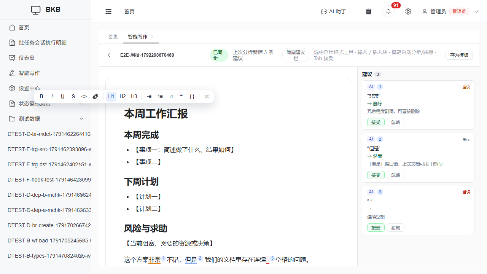

# 智能写作（suggest-editor）

Notion 式富文本编辑器：**停笔自动分析，建议以批注呈现，接受才落正文**。
文档与建议自动持久化，随时关页、刷新、重启服务后原样恢复。



## 入口

侧边栏 **「智能写作」**（角色：管理员/开发者，可在菜单管理中授权给其他角色）。

## 三层建议

| 来源 | 触发 | 呈现 | 说明 |
| --- | --- | --- | --- |
| 本地即时检查 | 输入即出（毫秒级） | 绿色小点 + 点线标注 | 连续空格、重复标点、半角逗号等机械规则，零网络零 token |
| AI 分析 | 停笔约 1 秒后 | 蓝色编号圆标 + 右侧卡片 | 由 OpenCode agent（ACP 模式）分析**变动段落**，未变段落命中块级缓存不重复分析 |
| 用户改写 | 选中 → 右键 | 紫色编号圆标 | 三个预设（美化/精简/更正式）或一句话指令，结果同样是「接受才生效」的建议卡片 |

- 建议永不直接改正文：点卡片或正文标记 → 侧栏卡片 → **接受**（写一次普通编辑，进协作历史）/**忽略**。
- 悬停卡片正文高亮加重；点击正文编号标记会选中对应文字并激活卡片。
- AI 分析只把「从未分析过的段落」送进模型：改动一段只重分析一段，token 与延迟都按块计价。
- 建议有 30 分钟过期时间（`SUGGEST_TTL_MS`），过期/原文已变的建议自动清理。

## 续写联想（ghost text）

光标停在**段尾**时按优先级降级：

1. **词表**（本地 ~200ms，命中不调模型）：`词表.txt` 支持前缀 / 模糊（`智应`→人工智能应用）/
   拼音首字母（`rgzn`→人工智能）/ 别名（输入 `AI` Tab 后替换为「人工智能」）/ 片段占位符
   （`主题：${1:议题}` 接受后 Tab 在占位符间跳转）；
2. **文档自学习**：当前文档的 n-gram 统计，续出你自己的说法；
3. **LLM 兜底**（可用 `VITE_LLM_COMPLETION=off` 关闭）。

候选列表是 IDE 式的：↑↓ 选择、Tab/Enter 接受、Esc 关闭、点击直接接受、Ctrl+Space 显示全部。
**Tab** 接受 ghost 文本（写入正文），**Esc** 忽略。

### 词表后台配置 / 导入 / 导出

词表不用再登服务器改文件，管理界面直接编辑：

- **全局词表**（对所有文档生效）：列表页「**词表管理**」按钮（需 `admin.suggest_editor` 权限）；
- **文档词表**（只对当前文档生效，优先于全局）：编辑页顶栏「**词表**」按钮（文档属主）；
- **保存后生效时机**：任意一次编辑（或重新打开文档）即热生效，无需重启服务；
- **导入**：选 `.txt` 文件，两种模式——「追加（去重）」按词条正文去重后并入（重名保留先出现的，
  注释与空行忽略），「覆盖」整文件替换；
- **导出**：下载当前词表 `.txt`（全局为 `词表-全局.txt`，文档级为 `词表.txt`）。

格式（`#` 为注释，一行一个词条）：

```
综上所述
人工智能|AI                                  # 别名：输入 AI 会替换为「人工智能」
主题：${1:议题} 时间：${2:日期} 结论：${3:待补充}   # 片段：接受后 Tab 在占位符之间跳转
```

文件落点（管理界面读写的就是它们，手工编辑同样有效）：

```
suggest-editor-server/.data/ws/<文档id>/词表.txt      # 文档级（优先）
suggest-editor-server/.data/词表-全局.txt             # 全局
```

## 编辑与排版

- **顶部固定工具栏**（2026-10-19）：纸张正上方常驻——撤销/重做、段落格式下拉（正文 / 标题 H1-H3 /
  无序/有序/任务列表 / 引用 / 代码块，随光标位置动态显示当前块类型）、加粗 / 斜体 / 下划线 /
  删除线 / 行内代码 / 链接（内联输入，可移除）、清除格式；点按钮不丢选区。
- 选中浮出工具栏、`/` 斜杠块菜单、Markdown 输入规则（`# `、`- `、`> `、``` 三个反引号）照常可用；
  快捷键 `Ctrl+B/I/U`、`Ctrl+K` 链接、`Ctrl+Alt+1..3` 标题、`Ctrl+Shift+7/8` 列表、`Ctrl+Z/Y` 撤销重做。
- 排版：标题层级与间距、列表缩进、任务列表勾选（勾选自动删除线）、引用竖线、代码块灰底、
  链接下划线、分割线、任务清单等 Notion 式行文节奏。

## 检查要点（AI 检查清单，后台可配）

针对技术文档的**业务描述与逻辑问题**，分析时逐条核对的检查清单：

- **入口**：列表页「**检查要点**」按钮（`admin.suggest_editor` 权限），可编辑 / 导入（追加去重、覆盖）/ 导出；
- **默认清单**面向技术文档预置四组要点：业务与数据描述（口径一致、数量自洽、术语一致、主体明确）、
  逻辑与流程（因果成立、时序合理、边界与例外、条件完备）、一致性与可执行性（前后文一致、可执行、
  安全与权限）、表达质量（冗余歧义、书面规范）——管理员可增删改；
- **生效机制**：AI 分析每轮把清单逐条注入 prompt（命中才提建议，reason 注明要点名）；
  保存后**新分析的段落**即按新要点查，已分析段落命中块级缓存不重查；
- **模型要求**：清单只对真 opencode（`AGENT_KIND=opencode`）生效——mock agent 是确定性规则，
  不读提示词语义；
- **只影响 AI 层**：本地即时检查（连续空格等机械规则）不走清单，它们在代码内毫秒级执行。

## 文档管理与模板

- **列表页**：按更新时间排序，支持打开 / 重命名 / 删除；「最近打开」在编辑器打开时刷新。
- **新建文档**：可选内置模板（空白 / 项目周报 / 会议纪要 / 方案建议书），模板内容原样灌入编辑器。
- **模板管理**（需 `admin.suggest_editor` 权限，默认管理员）：列表页「模板管理」可增删改模板；
  编辑页顶栏「**存为模板**」把当前文档另存为模板。模板正文是 Tiptap HTML
  （h1-h3 / p / ul / ol / taskList / blockquote / codeBlock 等）。
- 删除文档会同时清空正文、建议与 agent 工作区，**不可恢复**（写操作日志）。

## 自动保存与恢复

正文、建议、词表、改写命令都在同一份 Yjs 文档里，随编辑自动落库（数据库 `se_document_states`）；
「已分析段落」的缓存指纹一并持久化——**重启服务后不会对读过的段落重复花钱**。
未跑完的改写命令在重新打开文档后自动续跑。

可放心做的事：关标签页、刷新浏览器、重启后端、重启 Node 服务——重新打开文档即恢复到最新状态。

## 私有性

文档严格属主私有：列表、编辑、WebSocket 连接三处都按属主校验（非属主一律 404/拒绝），
管理员也没有旁路；管理面只覆盖模板。

## 运维要点

| 项 | 值 |
| --- | --- |
| Node 服务 | `suggest-editor-server/`（Hocuspocus WebSocket，端口 `SE_WS_PORT`，默认 1234） |
| dev 启动 | `npm run dev:all`（已含 se 服务，agent 钉 mock 保确定性）；想要真模型在 dev 用 `npm run se` |
| 生产启动 | `start.sh` / `proxy.py`（托管子进程，`/suggest-ws` 经 8080 隧道转发）。**改前端后必须 `npm run build`**，proxy 直接服务 `dist/`，浏览器强刷（Ctrl+F5）生效 |
| agent | 默认内置 mock（无需模型）；真模型在 `server/.env` 配 `AGENT_KIND=opencode` + `AGENT_MODEL=<provider>/<model>`（`opencode models` 查可选值），重启生效 |
| ⚠️ opencode 版本 | ACP 模式务必用 `OPENCODE_DIR` 指到平台自带的 oc126（1.2.26）——npm 全局 opencode 1.19.3 的 `session/prompt` 会返回 "OpenCode service failure"（2026-10-19 实测二分定位） |
| 数据 | 正文/建议在数据库（随系统备份）；agent 工作区在 `suggest-editor-server/.data/ws/`（快照与词表，临时数据不备份） |
| 体检 | `server/scripts/stale_check.py` 已识别 1234 端口（角色：智能写作(SE)） |
| 冒烟探针 | `node e2e/manual/suggest-editor-ws-smoke.mjs`（WS+落库，mock 即可）；`node e2e/manual/suggest-editor-real-agent-check.mjs`（真模型出建议，含检查要点命中验证） |
